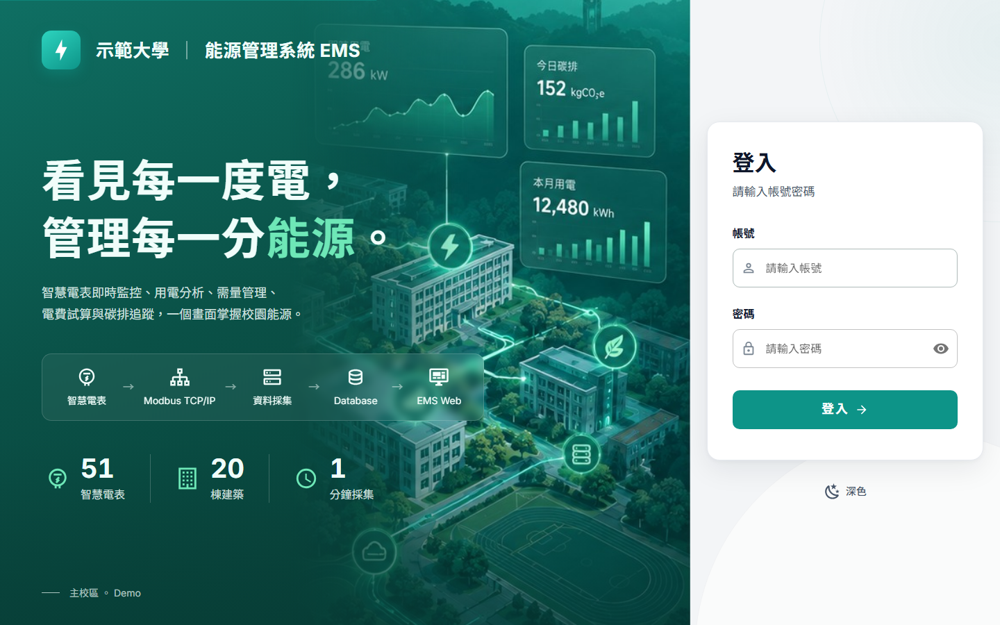
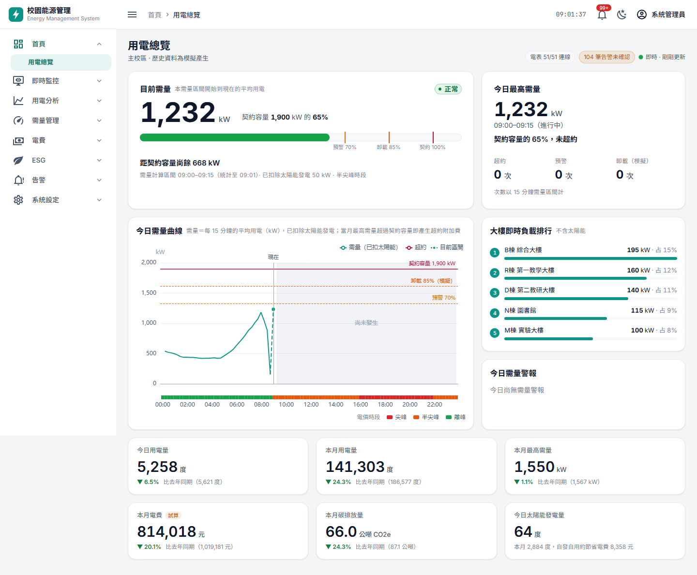
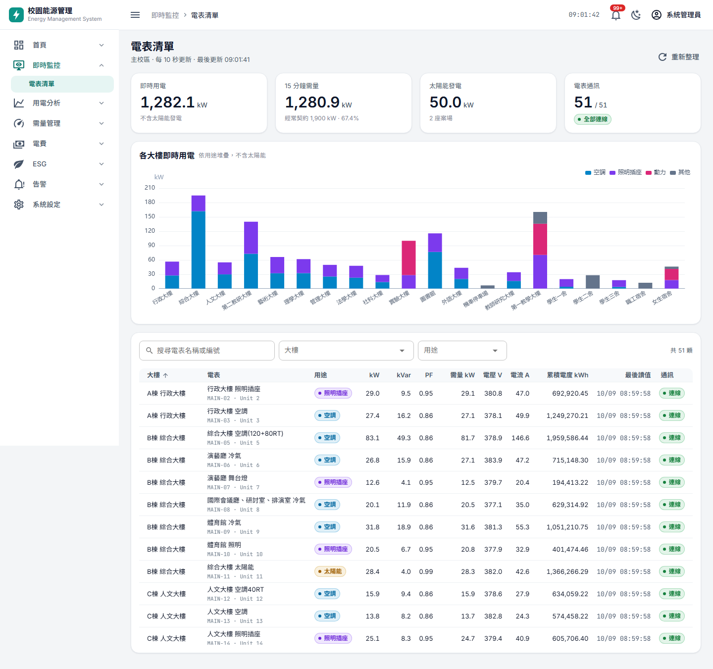
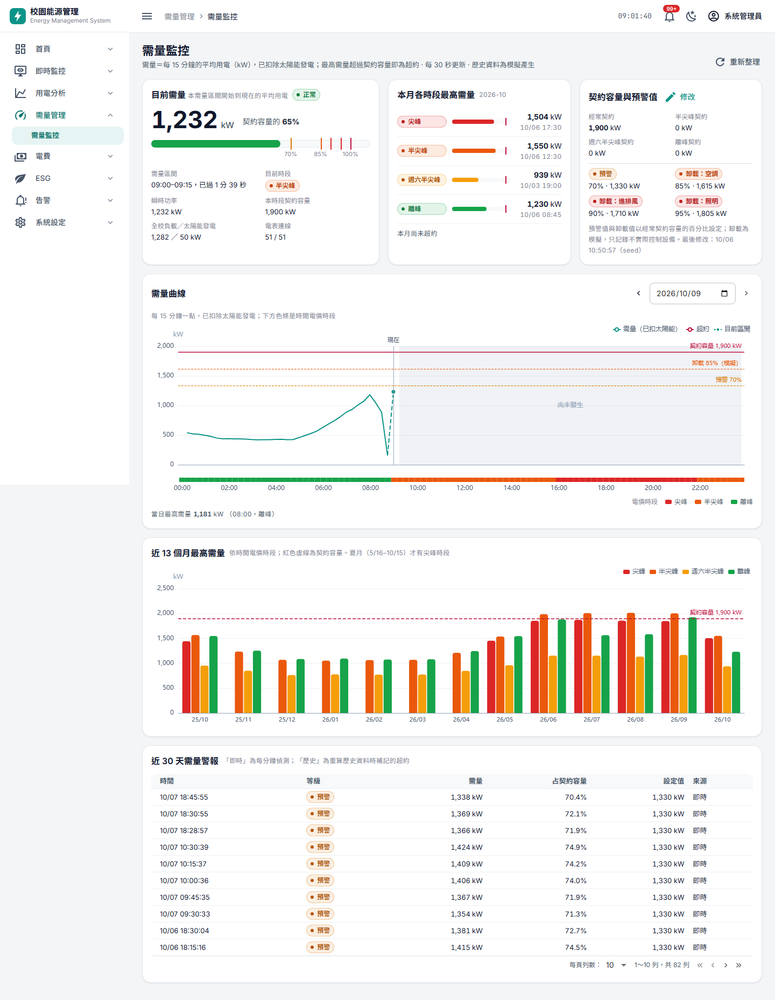
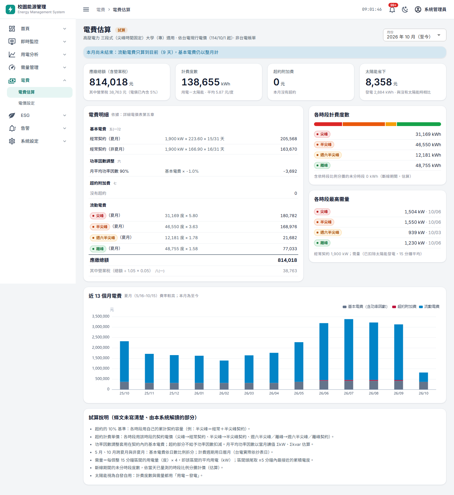
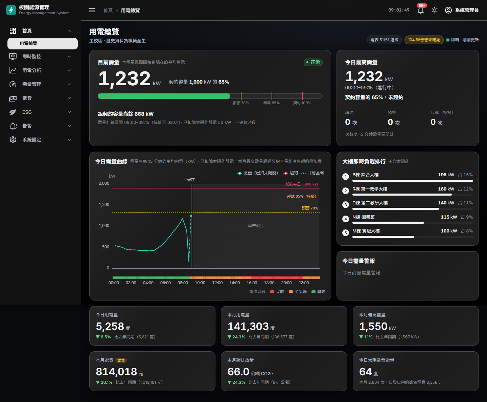

# Smart Campus EMS

**智慧校園能源管理系統**

An open-source campus energy management system built with Vue 3, ASP.NET Core, PostgreSQL and Modbus TCP.

以模擬智慧電表為起點，透過 **Modbus TCP** 採集讀值、存進 **PostgreSQL**，再由 **ASP.NET Core API** 與 **Vue 3／Quasar** 呈現即時監控、用電分析、需量管理、電費試算與碳排追蹤。不需要任何硬體，就能在本機跑起一整條 EMS 資料鏈。

   



> 本專案以本機開發與教學展示為主，目前沒有公開線上 Demo。學校、大樓、電表名稱皆為虛構，所有讀值由模擬器產生。

## 畫面預覽

| 用電總覽 | 電表清單 |
|---|---|
|  |  |
| **需量監控** | **電費估算** |
|  |  |

深色主題（戰情室模式）：



## 主要功能

| 分類 | 功能 |
|---|---|
| 登入與權限 | JWT 登入；`admin`（可改設定）／`viewer`（唯讀）兩種角色；修改自己的密碼 |
| 即時監控 | 51 顆電表的 V／A／kW／kVar／PF／kWh、通訊狀態、各大樓即時用電 |
| 用電分析 | 用電趨勢（小時／日／月）、用電結構（依大樓／用途／空間類型） |
| 需量管理 | 15 分鐘需量曲線、契約容量與預警／卸載門檻、需量事件（卸載只記錄，不控制設備） |
| 電費試算 | 依台電高壓三段式電價：基本電費、流動電費、功率因數、超約附加費；電價可設定 |
| 碳排追蹤 | 範疇二碳排（經濟部能源署電力排碳係數）、太陽能減碳、匯出 Excel |
| 告警 | 電表斷線、Modbus 連線中斷、需量預警／超約、資料缺漏 |
| 系統設定 | 契約與係數、電表設定（含測試 Modbus 連線）、使用者管理、稽核紀錄 |
| 介面 | 淺色（辦公室報表）／深色（戰情室）主題 |
| 模擬器 | Modbus TCP 模擬 51 顆電表；可產生 13 個月歷史讀值（含刻意安排的斷線事件） |

## 系統架構


```text
智慧電表／模擬器
→ Modbus TCP
→ 資料採集程式（ems_backend 內的 Collector，每 60 秒輪詢）
→ PostgreSQL
→ ASP.NET Core API（JWT）
→ Vue 3／Quasar
→ EMS Web Dashboard
```

## 資料流程

1. **採集**：Collector 以 Modbus TCP Client 身分連到電表（Server），讀取 Holding Registers，每分鐘一筆寫進 `meter_readings`。時間一律以 UTC 儲存。
2. **彙總**：以「整點前後 20 分鐘內最接近的累積電度」相減得出每小時用電，再彙總為日／月／年。找不到讀值就標示「不可計算」，**不補假資料**；斷線期間的總用電由前後電度相減，記為「未分時段」。
3. **需量**：每 15 分鐘用電 × 4 ＝ 需量（kW），與契約容量比較，產生需量事件與告警。
4. **計算**：電費、碳排在查詢時依電價表與排碳係數計算。依據與解讀整理在 [`docs/依據文件索引.md`](docs/依據文件索引.md)，畫面用語見 [`docs/名詞對照.md`](docs/名詞對照.md)。

## 技術棧

| 分類 | 技術 |
|---|---|
| Frontend | Vue 3.5、Vite 8、TypeScript 6、Quasar 2、ECharts 6、pnpm |
| Backend | ASP.NET Core（.NET 10）、EF Core 10＋Npgsql、JWT Bearer、Serilog、ClosedXML、Swagger |
| Data／Protocol | PostgreSQL 16、Modbus TCP（FluentModbus） |
| Simulator | .NET 10 Worker Service、FluentModbus（Modbus TCP Server） |
| Test | xUnit、vue-tsc、Playwright（headless 頁面檢查） |

## 專案目錄

```text
smart-campus-ems/
├─ ems_backend/      ASP.NET Core API／Modbus Collector／彙總與計算（含 xUnit 測試）
├─ ems_simulator/    Modbus TCP Smart Meter Simulator（含 backfill 指令與測試）
├─ ems_web/          Vue 3＋Quasar Web
├─ data/             電表主檔（虛構）、台電電價與能源署排碳係數公開文件
├─ db/               ems_demo.sql：資料庫結構＋主檔（不含帳號與讀值）
├─ docs/             畫面截圖、計算依據、名詞對照、操作手冊、AI 協作說明
├─ deploy/           本機 WSL 部署輔助腳本
└─ tools/            Playwright 頁面檢查腳本
```

## 快速開始

### 環境需求

| 工具 | 版本 |
|---|---|
| .NET SDK | 10.x |
| Node.js | 22.x |
| pnpm | 10 以上（`npm i -g pnpm`） |
| PostgreSQL | 16（本機安裝、WSL 或 Docker 皆可，需能從 `127.0.0.1:5432` 連線） |

啟動順序：**PostgreSQL → ems_simulator → ems_backend → ems_web → 瀏覽器**。以下以 Windows PowerShell 為例，macOS／Linux 把 `\` 換成 `/` 即可。

```bash
git clone https://github.com/terrypan1/smart-campus-ems.git
cd smart-campus-ems
```

### 1. Database 設定

開發設定 `ems_backend/EmsApi/appsettings.Development.json` 預設連到資料庫 `ems_dev`（帳密 `ems_dev / ems_dev_only`，僅供本機開發）。以 PostgreSQL 管理者身分執行：

```sql
CREATE ROLE ems_dev LOGIN PASSWORD 'ems_dev_only';
CREATE DATABASE ems_dev OWNER ems_dev;
```

資料表不用手動建立：後端第一次啟動會自動套用 EF Core migration，並寫入電表主檔、電價、排碳係數與開發帳號。

> 想先看資料表結構，也可以先匯入 `db/ems_demo.sql`（後端啟動時發現已建好就直接沿用）：
> `psql -h 127.0.0.1 -U ems_dev -d ems_dev -v ON_ERROR_STOP=1 -f db/ems_demo.sql`

連線設定不同時，用環境變數覆寫，不要改設定檔（變數清單見 [`.env.example`](.env.example)；本專案不會自動讀 `.env` 檔）：

```powershell
$env:ConnectionStrings__DefaultConnection = "Host=127.0.0.1;Port=5432;Database=ems_dev;Username=ems_dev;Password=<your-password>"
```

### 2. 啟動 Simulator

```powershell
cd ems_simulator\EmsSimulator
dotnet run --launch-profile dev        # Modbus TCP Server，port 1503
```

### 3. 啟動 Backend（另開終端機）

```powershell
cd ems_backend\EmsApi
dotnet run --launch-profile http       # http://localhost:5321，API 文件：/swagger
```

### 4. 啟動 Web（另開終端機）

```powershell
cd ems_web
pnpm install
pnpm dev                               # http://localhost:3021（/api 由 Vite 代理到 5321）
```

### 5. 開啟瀏覽器

開 http://localhost:3021 ，用開發帳號登入：

| 帳號 | 角色 | 密碼（開發用） |
|---|---|---|
| `sysadmin` | admin | `sysadmin-dev` |
| `admin` | admin | `admin-dev` |
| `viewer` | viewer（唯讀） | `viewer-dev` |

這些帳號在後端第一次啟動時由 `Seed__*Password` 設定建立（開發環境取自 `appsettings.Development.json`），只供本機使用。約 1 分鐘後電表清單會出現第一輪即時讀值。

### 6.（選用）產生 13 個月歷史資料

用電趨勢、電費、碳排頁需要歷史資料。等後端採集到至少一輪即時讀值後：

```powershell
cd ems_simulator\EmsSimulator
dotnet run -- backfill --connection "Host=127.0.0.1;Port=5432;Database=ems_dev;Username=ems_dev;Password=ems_dev_only"
```

完成後以 `sysadmin` 登入，到「系統設定 → 契約與係數」按 **全部重算彙總**（約 1–2 分鐘）。

## Modbus TCP 模擬器

`ems_simulator` 讓你**沒有實體智慧電表也能跑完整流程**：

```text
Smart Meter Simulator（一個 port、51 個 Unit ID＝51 顆電表）
      ↓ Modbus TCP
EMS Backend Collector（與接真實電表時是同一套程式）
      ↓
PostgreSQL
```

- 電表是 **Modbus Server**，EMS Collector 是 **Client**；每顆電表以 Unit ID 區分，讀 Holding Registers（電壓、電流、kW、kVar、PF、Hz、累積電度）。
- 負載依平日／週末曲線、季節與用途產生；累積電度會存檔，重啟不歸零。
- 開發用 port `1503`，可用任何 Modbus 用戶端工具（如 Modbus Poll、pymodbus）連上觀察。
- Register 配置見 [`RegisterMap.cs`](ems_simulator/EmsSimulator/RegisterMap.cs)（編碼）與 [`MeterRegisterDecoder.cs`](ems_backend/EmsApi/Services/Collector/MeterRegisterDecoder.cs)（解碼），兩邊必須一致並有單元測試。
- 接真實電表時不需要模擬器：在「系統設定 → 電表設定」改每顆電表的 Modbus 位址即可。

## 開發與測試

```powershell
cd ems_backend;   dotnet test EmsBackend.slnx      # xUnit
cd ems_simulator; dotnet test EmsSimulator.slnx    # xUnit
cd ems_web;       pnpm build                       # 含 vue-tsc 型別檢查
```

本機 WSL（systemd＋nginx）的部署輔助腳本放在 `deploy/wsl/`，說明見 [`docs/DEPLOYMENT.md`](docs/DEPLOYMENT.md)。專案目前以本機／WSL 開發與展示為主，尚未提供公開線上 Demo。

## AI-assisted Development

本專案開發時實際使用 **Claude Code** 與 **OpenAI Codex** 協助：Repository 盤點、任務拆分、Code Review、文件整理、測試與 Refactor。需求與取捨由人決定。

AI-generated changes are reviewed and validated before merge.

- [`CLAUDE.md`](CLAUDE.md)：Claude Code 的專案規則
- [`AGENTS.md`](AGENTS.md)：Codex 等 coding agent 的執行規則
- [`docs/AI_WORKFLOW.md`](docs/AI_WORKFLOW.md)：工作流程與任務範例

## 公開 Repo 安全原則

- 連線字串、JWT 金鑰、密碼一律用**環境變數**，不寫進 repo；`appsettings.Development.json` 只放本機開發用假值。
- 範例資料一律為合成／虛構資料，不含真實場域名稱、電表點位、內網資訊或營運資料。
- 安全問題回報方式見 [SECURITY.md](SECURITY.md)。

This repository is intended for demonstration and learning purposes. Do not commit production credentials, customer network information, private meter mappings, or real operational data.

## Roadmap

- [x] Modbus TCP simulator（51 顆電表、13 個月歷史 backfill）
- [x] Backend data collector／PostgreSQL raw readings
- [x] Login／role（admin、viewer）
- [x] Meter list／latest readings
- [x] Energy dashboard／historical energy analytics
- [x] Demand management
- [x] Electricity cost estimation
- [x] Carbon emission dashboard
- [x] Alarm management
- [ ] Email／LINE 告警通知
- [ ] 需量控制實際輸出（目前卸載只記錄）
- [ ] 更細的權限與 refresh token
- [ ] 多校區
- [ ] Docker Compose 一鍵啟動

## License

[MIT](LICENSE)
